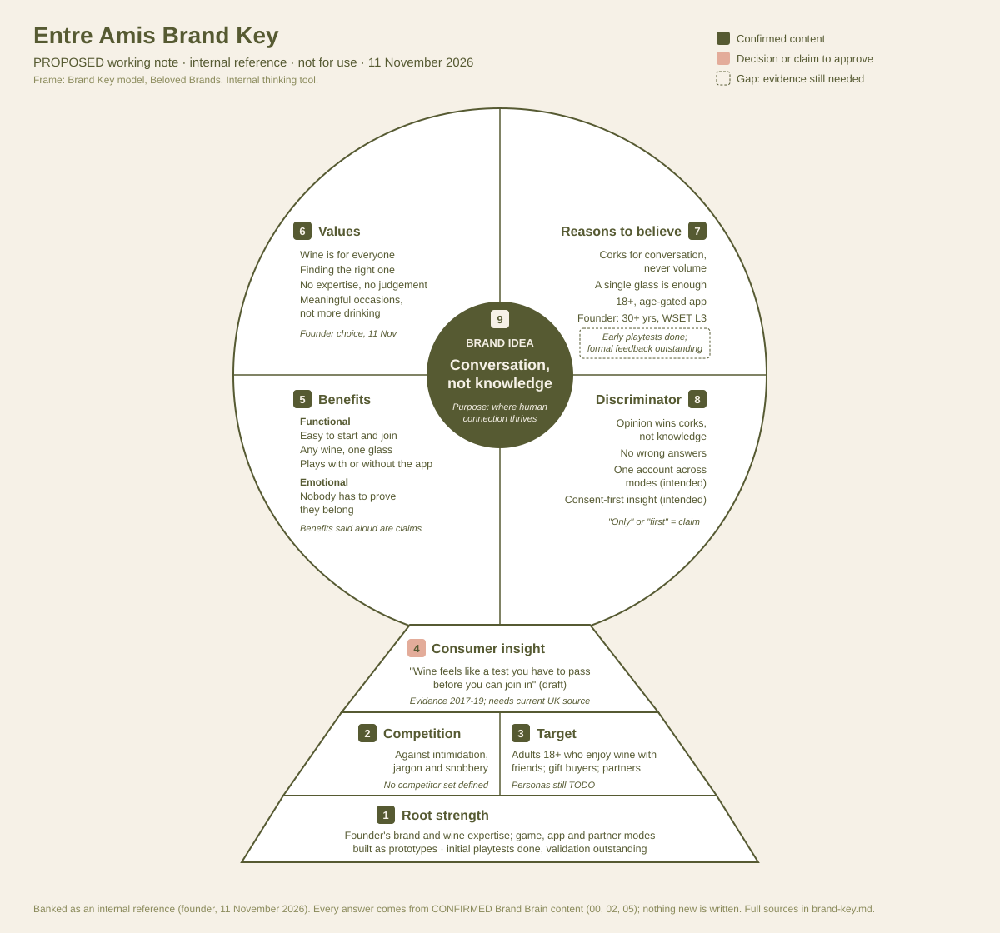

# Entre Amis Brand Key `PROPOSED`

> **Working note, banked for later.** Founder request, 11 November 2026. Not
> confirmed, not for output, not a new brand platform.
>
> The frame is the Brand Key model by Beloved Brands (reference image supplied
> by the founder): 1 Root strength, 2 Competition, 3 Target, 4 Consumer
> insight, 5 Functional and emotional benefits, 6 Values, 7 Reasons to
> believe, 8 Discriminator, 9 Brand idea. It is an internal thinking tool; the
> model is not referenced in any Entre Amis material.
>
> Every box is filled only with what the Brand Brain already says, with its
> source and status. Where the Brand Brain has nothing, the box says so. Words
> quoted here stay internal ([03](../03-guardrails.md#brand-brain-descriptions-are-not-consumer-copy-confirmed)).

---

## At a glance

| # | Box | Proposed Entre Amis answer (short) | How solid |
| --- | --- | --- | --- |
| 9 | **Brand idea** | Conversation, not knowledge | Confirmed wording |
| 8 | **Discriminator** | Corks are won for conversation, not knowing; no wrong answers | Confirmed facts; "only" or "first" would be a claim |
| 7 | **Reasons to believe** | The confirmed proof points and the founder's credentials | Confirmed, but no evidence from play yet |
| 6 | **Values** | What we believe (wine is for everyone; finding the right one; no expertise, no judgement; meaningful occasions, not more drinking) | Confirmed content; choosing it as "values" is a decision |
| 5 | **Benefits** | Functional: easy to start and join, any wine, a single glass. Emotional: nobody has to prove they belong | Confirmed content; emotional benefits are claims to approve |
| 4 | **Consumer insight** | Wine is made to feel like a test you have to pass first | Draws on confirmed point of view; market evidence is dated |
| 3 | **Target** | Adults 18+ who enjoy wine with friends, whatever they know; gift buyers; partners | Confirmed and deliberately broad; personas `TODO` |
| 2 | **Competition** | Against intimidation, jargon and snobbery | Confirmed stance; no competitor set |
| 1 | **Root strength** | A founder who knows both brands and wine, and a game, app and partner modes built and tested as prototypes | Confirmed facts; the strength itself is not yet proven |

## Box by box

Read bottom up, as the model is built.

### 1. Root strength

What the brand can do well that is hard to copy.

- **From the Brand Brain:** Caroline, a marketing and commercial leader with
  30+ years across UK and international brands, holding WSET Level 3 in Wines
  with Distinction ([00 proof points](../00-brand-core.md#proof-points), `CONFIRMED`).
  A physical game that is complete without the app, an app tested Host +
  Guest, and Partner Mode and Event Mode working live as prototypes
  ([00 feature status](../00-brand-core.md#feature-status--what-may-be-claimed-confirmed), `CONFIRMED`).
- **Proposed reading:** designing play that gets people talking about wine
  without needing to know about it, across the table, the app and partner
  tastings.
- **Gap:** this is our view of the strength, not evidence of it. Playtest
  results and partner feedback are still `TODO`
  ([evidence still needed](../00-brand-core.md#evidence-still-needed-todo)).

### 2. Competition

The space we compete in, and what we stand against.

- **From the Brand Brain:** what we stand against is wine made intimidating
  (technical labels, jargon, needing the right answer first) and judgement or
  snobbery ([00 point of view](../00-brand-core.md#our-point-of-view-confirmed), `CONFIRMED`).
  We are not a wine course or test, a drinking game, a screen-first experience
  or a judge of wine ([00 what Entre Amis is not](../00-brand-core.md#what-entre-amis-is-not-confirmed), `CONFIRMED`).
- **Proposed reading:** the competitor is the feeling, not a product: the
  wine list or shelf that makes people feel they need to know the answer.
- **Gap:** no competitive set is defined (other table games, wine tasting
  kits, tasting events and apps, or what partners use today). Naming
  competitors needs founder approval ([03](../03-guardrails.md#never)). UK table
  games data is a known gap ([05 gaps](../05-insight-bank.md#gaps-todo)).

### 3. Target

- **From the Brand Brain:** Players: adults 18+ who enjoy wine with friends,
  whatever they know, as Hosts and Guests, deliberately broad while we
  user-test. Gift buyers: adults 18+ buying for someone else. Partners: Partner
  Mode and Event Mode hosts ([00 audiences](../00-brand-core.md#audiences), `CONFIRMED`).
- **Gap:** player personas are `TODO` (no more than four, through testing). The
  founder's working ideas are not to be used until confirmed, so none are
  shown here. Who buys wine games, and when, is a known gap
  ([05 gaps](../05-insight-bank.md#gaps-todo)).

### 4. Consumer insight

- **From the Brand Brain:** wine "isn't about knowing the right answer; it's
  about finding the right one for you" ([00 point of view](../00-brand-core.md#our-point-of-view-confirmed), `CONFIRMED`).
  The observation "People want to enjoy themselves, not prove themselves."
  ([02 unattributed observations](../02-brand-voice.md#unattributed-observations-confirmed),
  `CONFIRMED` as an observation, never a quote). Supporting market findings:
  insights 8, 9 and 15 on intimidation and curiosity, 14 on games easing
  conversation, 7 on friends as the main drinking occasion
  ([05](../05-insight-bank.md), `CONFIRMED` with caveats).
- **Proposed insight (draft wording, internal):** *Lots of people enjoy wine
  but feel it's a test they have to pass before they can join in, so they
  hold back their opinion.*
- **Gaps:** the intimidation evidence is from 2017 to 2019 and brand- or
  retailer-commissioned; a current UK source is `TODO`. "People feel they need
  expertise before choosing a wine" is the founder's experience, not yet
  evidence ([00](../00-brand-core.md#evidence-still-needed-todo)). Entre Amis's
  own playtest findings would make this much stronger.

### 5. Functional and emotional benefits

- **Functional, from the Brand Brain** (`CONFIRMED`): easy to start and easy to
  join; 2–8 players; any wine, and a single glass is enough; complete without
  the app; the app adds plain-English wine information when curiosity
  appears and keeps My wines. For partners: understanding what visitors
  genuinely think, in their own words, with consent and anonymised
  ([00](../00-brand-core.md#the-offer--play--discover--experience-confirmed)).
- **Emotional, from the Brand Brain** (`CONFIRMED` wording, internal): "nobody
  has to prove they belong there"; the friend you want at the table; wines
  remembered because you were with friends, old and new
  ([00](../00-brand-core.md#how-entre-amis-behaves--the-friend-you-want-at-the-table-confirmed)).
- **Flags:** any benefit said to the outside ("makes conversation easier",
  "more confident") is a claim: `CLAIM — needs founder approval`. Credit the
  table and the people, never the wine
  ([03 responsible drinking](../03-guardrails.md#responsible-drinking-confirmed)).

### 6. Values

- **From the Brand Brain:** there is no list called "values". The nearest
  confirmed content is *What we believe*: wine is for everyone; it's about
  finding the right one; no expertise required, no judgement; meaningful
  occasions, not more drinking; wine is the first expression of a wider brand
  about connection ([00 point of view](../00-brand-core.md#our-point-of-view-confirmed)).
  The tone (warm, curious, premium, playful) is how we sound
  ([02](../02-brand-voice.md#core-tone--premium-accessible-and-never-judgemental-confirmed)).
- **Proposed:** use *What we believe* as the values, and leave the tone words
  as voice. Founder decision.

### 7. Reasons to believe

- **From the Brand Brain** (`CONFIRMED` proof points): 18+ with an age-gated
  app; corks won for conversation and play, not volume; a single wine and a
  single glass are enough; founded by Caroline (30+ years in marketing and
  commercial leadership; WSET Level 3 with Distinction). Features claimable
  as in development ([00](../00-brand-core.md#feature-status--what-may-be-claimed-confirmed)).
- **Gap:** no evidence from play yet: playtest results, player feedback,
  partner and organiser feedback are all `TODO`. Market insights in 05 are
  never evidence about Entre Amis.

### 8. Discriminator

What sets Entre Amis apart.

- **From the Brand Brain** (`CONFIRMED`): corks are won for sharing, not for
  knowing, and never for drinking; no wrong answers; experts and newcomers at
  the same table; one game that plays the same with or without the app; the
  same account carrying a Guest's favourites from a friend's table to a
  partner's tasting; consent-first, anonymised insight for partners.
- **Proposed reading:** *a wine game where opinion wins, not knowledge.*
- **Flag:** saying any of this is unique ("the only", "first") is a claim, and
  there's no competitive review to support it yet. `CLAIM — needs founder approval`.

### 9. Brand idea

- **From the Brand Brain** (`CONFIRMED`): the idea is **Conversation, not
  knowledge** (also supporting line 2). The purpose is **Where human
  connection thrives** (internal). The brand positioning is "Where
  conversation matters more than knowledge" (internal).
- **Proposed:** *Conversation, not knowledge* at the centre, with the purpose
  as the why behind it. Nothing new is written. The consumer brand line stays
  `TODO` and is not decided here.

## Gaps to close before this could be confirmed

1. Entre Amis's own evidence: playtests, player and partner feedback.
2. A current UK source on wine intimidation and confidence.
3. A defined competitive set (founder to name, or approve naming).
4. Player personas, through testing.
5. Who buys wine games, and when.
