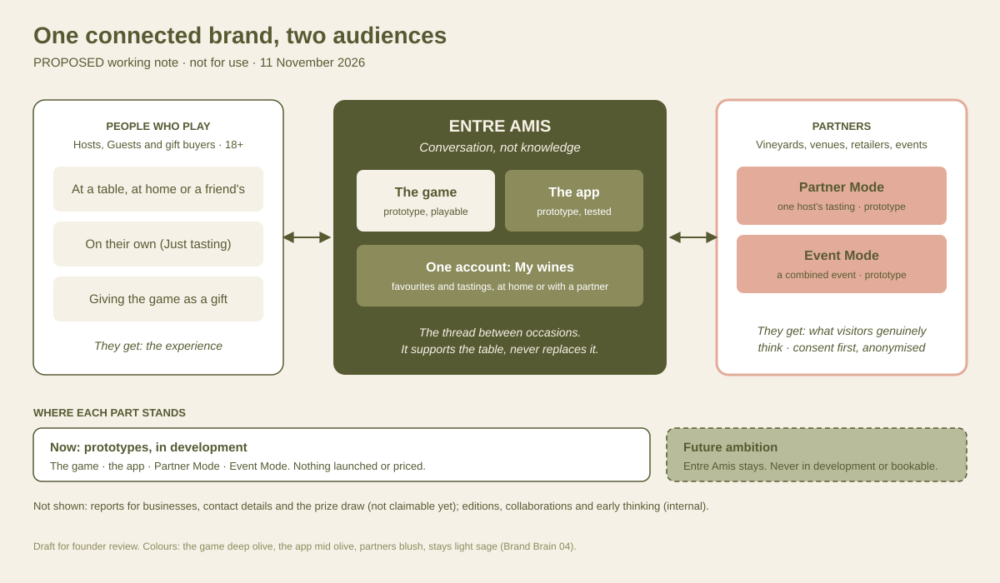

# One connected brand, two audiences `PROPOSED`

> **Working note, banked as an internal reference** (founder, 11 November
> 2026). Not confirmed, not for output. The founder agreed the direction and
> asked for no further strategic development at this stage. The Full Story
> master (51 slides) and the Mirabeau selection are untouched.
>
> Built only from: Full Story slide 9 (as it stands in the Google Slides
> master, 11 November 2026), [00 brand core](../00-brand-core.md),
> [02 brand voice](../02-brand-voice.md), [04 visual identity](../04-visual-identity.md)
> and, for the internal view only, [06 commercial](../06-commercial.md).

---

## The idea in one line

Entre Amis is one brand that serves **people who play** and **partners who
host**, joined by the same idea (conversation, not knowledge) and the same
app account, so every way of taking part adds to one relationship.

## What slide 9 shows today

Title *Guest • Entre Amis • Partner*, subtitle *How shared experiences create
lasting relationships*, three columns (Guest, Entre Amis, Partner) of four
bullets each, and the line *The experience comes first. Relationships and
understanding grow from it.* It sits in the Partner + Event section.

What it does well: it puts Entre Amis in the middle, and it shows that both
sides get something. What it doesn't yet show:

- **Which products make the connection.** "Games, app and experiences" is one
  bullet; the game, app, Partner Mode and Event Mode aren't named or placed.
- **What is real now and what is ambition.** Stays sit inside "experiences"
  with no stage shown.
- **What actually joins the two sides.** The confirmed link is concrete: a
  Guest at a Partner Mode tasting has the same email-identified account, and
  their favourites go into **My wines**, just as they do at a friend's table
  ([00, Partner Mode and Event Mode](../00-brand-core.md#partner-mode-and-event-mode-confirmed)).

## Proposed visual

Expression colours as confirmed in [04](../04-visual-identity.md#expression-colours-confirmed):
the game deep olive, the app mid olive, partners blush, stays light sage.
Solid shapes are prototypes in development. Dashed outlines are **intended
capabilities not yet demonstrated** (partner insight, and one account carried
across home and partner tastings) or **ambition** (stays). Nothing here
implies a proven partner outcome.

The same picture in words:

| | People who play | Entre Amis (the middle) | Partners |
| --- | --- | --- | --- |
| **Who** | Players (Hosts and Guests) and gift buyers, 18+ | The idea: conversation, not knowledge | Partner Mode: one vineyard, wine brand, bar, restaurant, retailer or wine club. Event Mode: festivals, tasting events, regional wine bodies |
| **How they take part** | The game, the app, Just tasting | The game and the app hold it together. Intended, not yet demonstrated: one account (My wines) carrying a Guest's favourites from home to a partner tasting | A hosted tasting or a combined event, run through the app |
| **What they get** | The experience: conversation, discovery, wines remembered | — | Intended, not yet demonstrated: insight into what visitors genuinely think, with consent, anonymised and aggregated. Reports are built in the prototype but no partner has seen one |

## Now, next, ambition

| Band | What sits in it | How it may be described (from [00 feature status](../00-brand-core.md#feature-status--what-may-be-claimed-confirmed)) |
| --- | --- | --- |
| **Now: prototypes** | The game; the app (hosting, Wine 101, My wines, Just tasting, wine recognition); Partner Mode; Event Mode | In development. Partner Mode to partners only. Nothing launched or priced |
| **Not claimable yet** | Reports for businesses; contact details to partners; the Event Mode prize draw | Not shown as features. Reports only as illustrative if the [Fizz Fest proposals](../00-brand-core.md#proposed-changes-from-the-fizz-fest-deck-proposed) are confirmed |
| **Future ambition** | Entre Amis stays | Never as in development, bookable or priced. Showing it at all depends on the `PROPOSED` [stays as part of the vision](../00-brand-core.md#stays-as-part-of-the-vision-proposed) |
| **Not shown at all** | Early thinking (game mat editions, artist editions, non-wine expressions); themed editions and Curated Collaborations; trend reports | Internal only ([00](../00-brand-core.md#early-thinking--not-for-external-use-confirmed), [06](../06-commercial.md)) |

## Founder decisions (11 November 2026)

- **Two audiences here, three commercial routes in 06.** They describe
  different aspects of the business and are complementary: this diagram is
  the brand view; the [commercial story](../06-commercial.md#the-commercial-story-proposed)
  keeps its three markets.
- **Intended, not proven.** Partner insight and the shared account across
  modes are shown as intended capabilities until they have been demonstrated.
  No partner outcomes are implied.
- **Mirabeau.** The founder asked for this diagram to be tried in the latest
  Mirabeau deck, with a report on whether it duplicates, needs simplifying or
  helps the story. That work sits with the Mirabeau thread; the Full Story
  master is not changed.

## Two versions, if it is ever built

- **Brand or partner version.** The picture above: who takes part, how, and
  what each side gets. No revenue, no pricing, no flywheel. Works with the
  [brand journey](../00-brand-core.md#the-brand-journey--inspire--discover--experience--belong-confirmed)
  rather than replacing it: the journey is the "why people stay", this is the
  "how the parts connect".
- **Internal version.** The same picture with the [commercial story](../06-commercial.md#the-commercial-story-proposed)
  laid over it (who pays for what). Internal only, as the founder decided on
  30 October 2026.

## Checks and flags

- **Claims to approve before any use.** Slide 9's *Returns, recommends or
  hosts again* and *Supports ongoing relationships* describe behaviour we have
  no evidence for yet. Any arrow that says partners *bring new people* to
  Entre Amis is the 06 claim "introduce new people to Entre Amis", which is
  still to approve. `CLAIM — needs founder approval`.
- **Internal language.** "Network", "two audiences", "consumers" and "commercial"
  are working terms here. On a partner-facing version, use Guests, visitors,
  partners, and "what your visitors get / what you get"
  ([02 partner materials](../02-brand-voice.md#partner-materials--who-were-talking-to-confirmed)).
- **The app supports the table.** The app sits in the middle as the thread
  between occasions, never as the experience itself
  ([00, what Entre Amis is not](../00-brand-core.md#what-entre-amis-is-not-confirmed)).
- **Possible later use:** the Mirabeau conversation, the Partner and Event
  packs, the website's Partners page. Not added anywhere now.
